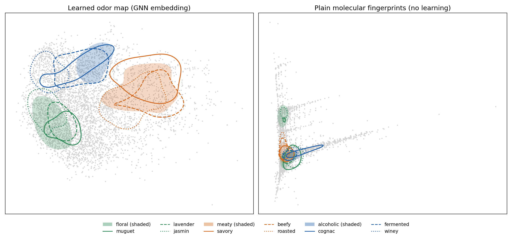
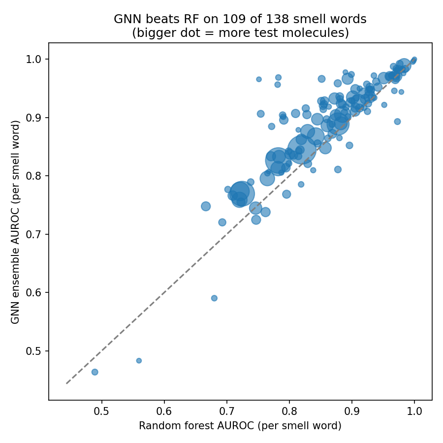

# 👃 AI nose: predicting how a molecule smells

**Live demo:** _coming soon_ · **Model:** [sachin-kukkar/ai-nose-openpom](https://huggingface.co/sachin-kukkar/ai-nose-openpom)

A reproduction and extension of Google Research's work on predicting smell from molecular structure
(Sanchez-Lengeling et al. 2019; Lee et al., *Science* 2023). Built with OpenPOM, DeepChem and DGL,
and trained on a laptop GPU (RTX 3050, 4 GB).

## Results (held-out test set, 495 molecules)
| Model | Test ROC-AUC (mean over 138 smell words) | 95% CI |
|---|---|---|
| **GNN ensemble (10 × MPNN)** | **0.891** | 0.880–0.901 |
| Random forest on Morgan fingerprints | 0.862 | 0.849–0.874 |
| Difference | +0.029 | 0.021–0.036 |

- In line with published results: OpenPOM benchmark 0.887; Sanchez-Lengeling et al. 0.894 (different splits).
- The GNN beats the random forest on 109 of 138 smell words, with the same exception as the 2019 paper (anisic).
- The learned 256-number embedding works as an odor map: kNN on it scores 0.818 vs 0.794 for fingerprints (paper: 0.818 vs 0.782).

## Can an LLM smell?
A 4B open LLM (Qwen3-4B-Instruct, run locally with Ollama) picked 5 of the 138 smell words for each test molecule, from its SMILES.

| Method | Precision@5 |
|---|---|
| GNN ensemble | 0.480 |
| Copy the 5 nearest training molecules' smells (no LLM) | 0.417 |
| LLM + the same 5 retrieved neighbours (RAG) | 0.362 |
| Always guess the 5 most common smells | 0.275 |
| LLM zero-shot | 0.193 |

- Zero-shot, the LLM is significantly worse than a trivial baseline (−0.082, 95% CI −0.099 to −0.066). It says "fruity" for 93% of molecules (true rate: 39%).
- Retrieval nearly doubles its precision, but the LLM still does worse than simply counting the evidence it was given (−0.055, 95% CI −0.072 to −0.038).
- Takeaway: for this task, the specialist model should make the prediction; an LLM is better suited to explaining it.

Full numbers, checks and engineering notes: [RESULTS.md](RESULTS.md).

## What's in this repo
| Path | What it is |
|---|---|
| `notebooks/01_explore_data.ipynb` | Load data, build molecular graphs, iterative stratified split |
| `notebooks/02_train.ipynb` | First training runs |
| `notebooks/03_ensemble.ipynb` | 10-model ensemble with early stopping; prediction function |
| `notebooks/04_baseline.ipynb` | Random-forest baseline, bootstrap CIs, per-smell comparison |
| `notebooks/05_odor_map.ipynb` | Odor-map figure, kNN test, nearest neighbours |
| `notebooks/06_llm_eval.ipynb` | LLM zero-shot and retrieval experiments |
| `notebooks/07_app_prep.ipynb` | App files, Docker files, model upload |
| `streamlit_app.py` | The live web app (Streamlit) |
| `app/` | Gradio version of the app, with a Dockerfile |
| `llm_eval/` | Every LLM answer, for reproducibility |

## Run it yourself
- **Web app:** on Linux or WSL with Python 3.10, run `pip install -r requirements.txt`, then `streamlit run streamlit_app.py`. The weights download automatically from the Hugging Face Hub.
- **Training:** a Python 3.10 environment with PyTorch 2.4 (CUDA 12.4), DGL 2.4, DeepChem (nightly) and OpenPOM. Then run the notebooks in order.

## Limitations
- One fixed split, no cross-validation. Labels come from perfumery catalogues: noisy, biased toward pleasant materials, single molecules only.
- The LLM experiments use one small model and one prompt style.

## Credits
- Sanchez-Lengeling et al. (2019), *Machine Learning for Scent*. Lee et al. (2023), *A principal odor map unifies diverse tasks in olfactory perception*, Science 381.
- [OpenPOM](https://github.com/BioMachineLearning/openpom) (model implementation and the curated GoodScents + Leffingwell dataset), DeepChem, DGL, RDKit.
- Code: MIT license. Model weights: research and education use (see the model card).
